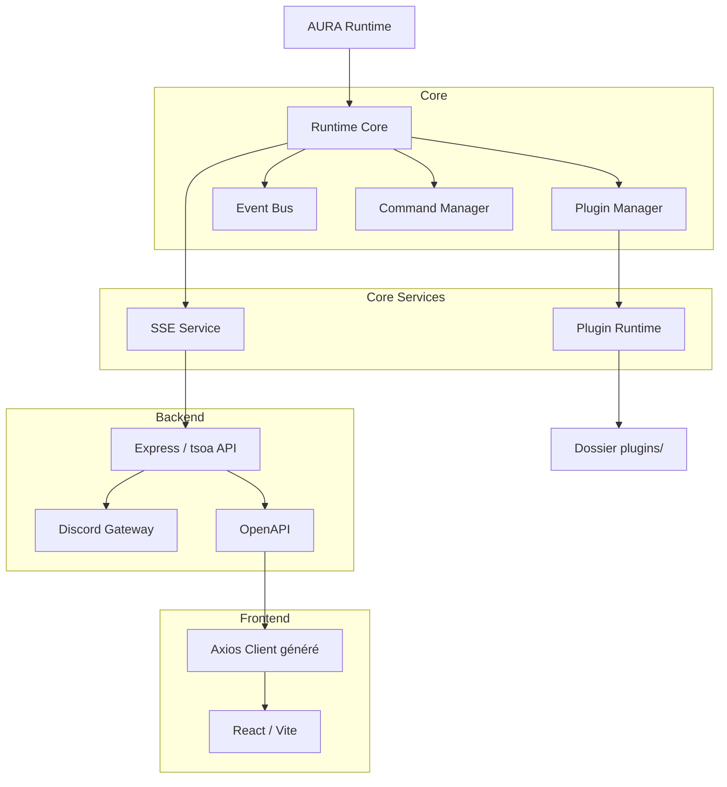

# Plan d'implémentation technique – AURA

Je te propose de construire AURA comme un bot Discord modulaire à chaud, avec une architecture en monorepo pnpm, proche de celle d'EDComet, mais adaptée à un système de plugins dynamiques.

L'objectif principal est de disposer d'un noyau stable qui assure la communication avec Discord, expose une API REST et SSE, et délègue les fonctionnalités à des plugins indépendants.

Les plugins doivent pouvoir être ajoutés, activés, désactivés ou retirés simplement en manipulant leur dossier, sans redémarrer AURA.

On conserve également :

- TypeScript sur l'ensemble du projet.
- Node.js pour le backend.
- Express et tsoa pour l'API REST.
- OpenAPI Generator pour le client frontend.
- React + Vite + TypeScript pour l'interface.
- SSE pour les notifications temps réel.
- pnpm Workspace pour le monorepo.
- Aucune base de données et aucune persistance des données métier.

Le document EDComet sert de référence pour le découpage `backend / frontend / shared`, les contrats générés, la séparation contrôleurs/services et le fonctionnement REST + SSE.&#x20;

plan-architecture-technique.md

## 1. Objectifs et périmètre

# AURA

MODULAR DISCORD BOT

One core. Infinite possibilities.

Modulaire

Plugins indépendants et extensibles.

Dynamique

Chargement et déchargement à chaud.

Temps réel

Notifications SSE et événements Discord.

Sans persistance

État métier conservé en mémoire uniquement.

### Fonctionnalités du noyau

Le noyau AURA sera responsable de :

1. La connexion à Discord.
2. La gestion du cycle de vie des plugins.
3. La découverte automatique des dossiers de plugins.
4. L'enregistrement et la suppression des commandes Discord.
5. La gestion des événements Discord.
6. La gestion des interactions entre plugins.
7. L'exposition de l'API REST.
8. La diffusion des événements via SSE.
9. La supervision de l'état des plugins.
10. La gestion de la configuration et des permissions.

### Hors périmètre initial

- Base de données.
- Persistance des utilisateurs, serveurs ou événements.
- Marketplace de plugins.
- Exécution de plugins distants.
- Interface de création de plugins.
- Système de distribution automatique de plugins.

## 2. Architecture globale

Je recommande de conserver trois packages principaux, comme dans EDComet, avec un quatrième emplacement indépendant pour les plugins.

## 2.1. Vue d'ensemble des composants

## Architecture logique cible



Architecture logique cible. Les plugins sont chargés dans le processus Node.js principal.

### 2.2. Découpage du monorepo

```
aura/
├── backend/
│   ├── src/
│   │   ├── core/
│   │   │   ├── Aura.ts
│   │   │   ├── PluginManager.ts
│   │   │   ├── PluginLoader.ts
│   │   │   ├── PluginRegistry.ts
│   │   │   ├── PluginWatcher.ts
│   │   │   └── PluginDependencyResolver.ts
│   │   ├── discord/
│   │   │   ├── DiscordClient.ts
│   │   │   ├── CommandManager.ts
│   │   │   ├── EventHandler.ts
│   │   │   └── InteractionRouter.ts
│   │   ├── events/
│   │   │   ├── EventBus.ts
│   │   │   └── InternalEvents.ts
│   │   ├── services/
│   │   ├── controllers/
│   │   ├── routes/
│   │   ├── sse/
│   │   ├── plugins/
│   │   ├── config/
│   │   └── index.ts
│   └── package.json
│
├── frontend/
│   ├── src/
│   │   ├── app/
│   │   ├── pages/
│   │   ├── components/
│   │   ├── features/
│   │   ├── services/
│   │   ├── hooks/
│   │   ├── utils/
│   │   │   ├── api.ts
│   │   │   └── stream/
│   │   └── assets/
│   └── package.json
│
├── shared/
│   ├── types/
│   │   ├── plugin.ts
│   │   ├── events.ts
│   │   ├── api.ts
│   │   └── discord.ts
│   ├── constants/
│   └── index.ts
│
├── plugins/
│   ├── example/
│   │   ├── manifest.json
│   │   ├── package.json
│   │   └── dist/
│   │       └── index.js
│   └── ...
│
├── docs/
├── scripts/
├── .env.example
├── package.json
├── pnpm-workspace.yaml
└── tsconfig.base.json
```

Décision importante : le dossier `plugins/` est extérieur au workspace pnpm. Un plugin doit être installable et chargeable sans modifier les dépendances du monorepo ni déclencher une installation globale.

Pour la première version, je recommande que les plugins soient exclusivement des extensions backend. L'interface React les découvre et les administre dynamiquement. Les interfaces React personnalisées par plugin pourront être ajoutées ultérieurement avec un mécanisme de chargement de bundles distinct.

## 3. Architecture du système de plugins

C'est le composant le plus important d'AURA. Il faut le concevoir avant les premières fonctionnalités Discord.

### 3.1. Structure d'un plugin

Chaque plugin dispose de son propre dossier :

```
plugins/
└── welcome/
    ├── manifest.json
    ├── package.json
    ├── dist/
    │   └── index.js
    ├── assets/
    └── README.md
```

Le `manifest.json` décrit le plugin :

```
{
  "id": "welcome",
  "name": "Welcome",
  "version": "1.0.0",
  "description": "Welcome new Discord members",
  "main": "dist/index.js",
  "auraVersion": "^1.0.0",
  "dependencies": [],
  "permissions": [
    "discord.guilds",
    "discord.members",
    "discord.messages"
  ]
}
```

Le manifeste sera validé avec Zod avant tout chargement.

### 3.2. Contrat d'un plugin

Chaque plugin implémente une interface commune :

```
export interface AuraPlugin {
  onLoad(context: PluginContext): Promise<void>;

  onEnable(): Promise<void>;

  onDisable(): Promise<void>;

  onUnload(): Promise<void>;
}
```

Le contexte donne accès aux ressources du noyau :

```
export interface PluginContext {
  logger: Logger;
  discord: DiscordService;
  events: EventBus;
  commands: CommandRegistry;
  services: ServiceRegistry;
  config: PluginConfig;
}
```

Responsabilités des hooks :

| Hook        | Responsabilité                                  |
| ----------- | ----------------------------------------------- |
| `onLoad`    | Initialisation et enregistrement des ressources |
| `onEnable`  | Activation effective des fonctionnalités        |
| `onDisable` | Arrêt des fonctionnalités et désenregistrement  |
| `onUnload`  | Libération définitive des ressources            |

Il faudra également prévoir une méthode de nettoyage systématique des listeners, timers et tâches asynchrones.

### 3.3. Cycle de vie dynamique

## Cycle de vie d'un plugin

1. Détection

   Le PluginWatcher détecte un nouveau dossier.
2. Validation

   Vérification du manifeste, de la version et des dépendances.
3. Chargement

   Import dynamique du module JavaScript.
4. Initialisation

   Exécution de `onLoad()` et enregistrement des ressources.
5. Activation

   Exécution de `onEnable()` et publication des commandes.
6. Surveillance

   Le plugin fonctionne normalement.
7. Désactivation / déchargement

   Suppression des commandes, listeners, routes et ressources.

### 3.4. Surveillance des dossiers

Je recommande `chokidar` pour surveiller le répertoire `plugins/`.

Les opérations détectées :

| Opération filesystem         | Comportement AURA                       |
| ---------------------------- | --------------------------------------- |
| Nouveau dossier              | Découverte et chargement                |
| Modification du manifeste    | Validation et rechargement              |
| Modification du code compilé | Rechargement du plugin                  |
| Suppression du dossier       | Désactivation et déchargement           |
| Dépendance manquante         | Plugin en erreur, sans bloquer le noyau |

Il faut toutefois éviter de recharger un plugin à chaque écriture de fichier pendant une compilation.

Je recommande :

- Un debounce de 500 à 1000 ms.
- Un dossier temporaire de staging pendant l'installation.
- Un chargement uniquement lorsque le build est terminé.
- Un mécanisme de remplacement atomique de l'ancienne version par la nouvelle.

Attention : Node.js met en cache les modules importés. Le rechargement devra gérer explicitement le cache des modules ESM et leurs dépendances. Un simple `import()` ne suffit pas à garantir le remplacement d'une version déjà chargée.

Pour garantir une bonne isolation du cycle de vie, chaque plugin aura son propre registre de ressources et son propre `AbortController`.

### 3.5. Commandes Discord

Les plugins pourront déclarer leurs commandes :

```
export interface AuraCommand {
  data: SlashCommandBuilder;
  execute(context: CommandContext): Promise<void>;
}
```

Exemple :

```
export default class WelcomePlugin
  implements AuraPlugin {

  async onLoad(context: PluginContext) {
    context.commands.register({
      data: new SlashCommandBuilder()
        .setName("welcome")
        .setDescription("Welcome configuration"),

      execute: async () => {
        // Business logic
      }
    });
  }

  async onEnable() {}

  async onDisable() {}

  async onUnload() {}
}
```

Le `CommandManager` sera responsable de la publication des commandes auprès de Discord.

Point important : les commandes globales Discord ne sont pas nécessairement visibles immédiatement après leur modification. Pour les tests, il faudra privilégier les commandes de guildes de développement, qui sont beaucoup plus pratiques pour valider les changements à chaud.

## 4. Backend : API, services et événements

### 4.1. Technologies

| Technologie             | Utilisation              |
| ----------------------- | ------------------------ |
| Node.js                 | Runtime                  |
| TypeScript              | Langage                  |
| Express                 | Serveur HTTP             |
| tsoa                    | Contrôleurs et OpenAPI   |
| discord.js              | Communication Discord    |
| Chokidar                | Surveillance des plugins |
| Zod                     | Validation des manifests |
| EventEmitter / EventBus | Événements internes      |
| Pino                    | Logging                  |
| Jest                    | Tests                    |

### 4.2. Organisation des contrôleurs

Je recommande de conserver une API centrale relativement stable.

Quelques exemples :

| Méthode | Endpoint                   | Fonction            |
| ------- | -------------------------- | ------------------- |
| GET     | `/api/health`              | Santé du bot        |
| GET     | `/api/bot/status`          | État de Discord     |
| GET     | `/api/plugins`             | Liste des plugins   |
| GET     | `/api/plugins/:id`         | Détails d'un plugin |
| POST    | `/api/plugins/:id/enable`  | Activation          |
| POST    | `/api/plugins/:id/disable` | Désactivation       |
| POST    | `/api/plugins/:id/reload`  | Rechargement        |
| GET     | `/api/events`              | Flux SSE            |

### 4.3. Point d'attention : tsoa et les routes des plugins

Il y a une distinction technique importante à conserver.

`tsoa` génère ses routes et son OpenAPI à partir des contrôleurs connus à la compilation. Il ne découvrira pas automatiquement les nouveaux contrôleurs présents dans les plugins.

Je recommande donc deux niveaux :

1. API Core : contrôleurs Express/tsoa classiques, documentés et générés par OpenAPI Generator.
2. API Plugins : accès dynamique par un routeur central, par exemple `/api/plugins/:pluginId/...`.

Les plugins pourront enregistrer des handlers dans ce routeur via le `PluginContext`.

Ainsi, on conserve le typage et la génération du client Axios pour l'API principale, sans sacrifier la modularité.

### 4.4. Event Bus

Le noyau disposera d'un bus d'événements interne.

Exemples :

```
type AuraEvent =
  | { type: "plugin.loaded"; pluginId: string }
  | { type: "plugin.unloaded"; pluginId: string }
  | { type: "plugin.error"; pluginId: string; error: string }
  | { type: "discord.ready" }
  | { type: "discord.guild.join"; guildId: string };
```

Les plugins pourront publier et écouter des événements sans dépendre directement les uns des autres.

Cela facilitera notamment l'ajout de fonctionnalités qui interagissent entre elles.

### 4.5. SSE

On conserve le modèle d'EDComet : le SSE transporte des notifications, et React recharge les données utiles via REST.

Exemple :

```
interface AuraSseEvent {
  type:
    | "bot.status"
    | "plugin.updated"
    | "plugin.error"
    | "discord.event";

  payload?: unknown;
  timestamp: number;
}
```

Côté React :

```
const stream = new EventSource("/api/events");

stream.addEventListener("plugin.updated", () => {
  queryClient.invalidateQueries({
    queryKey: ["plugins"]
  });
});
```

Il faudra prévoir :

- Reconnexion automatique.
- Heartbeat serveur.
- Fermeture des connexions lors de l'arrêt du serveur.
- Nettoyage des listeners.
- Filtrage des événements.
- Gestion des connexions SSE multiples.

## 5. Gestion des données et absence de stockage

Cette contrainte influence directement l'architecture.

AURA ne disposera d'aucune base de données et ne conservera aucune donnée métier après son arrêt.

### 5.1. Gestion de l'état

| Élément                | Stockage            | Durée de vie                        |
| ---------------------- | ------------------- | ----------------------------------- |
| Connexion Discord      | Mémoire             | Session                             |
| État des plugins       | Mémoire             | Session                             |
| Configuration runtime  | Mémoire             | Session                             |
| Cache métier           | Mémoire             | Session                             |
| Événements internes    | Mémoire             | Session                             |
| Connexions SSE         | Mémoire             | Connexion                           |
| Données utilisateurs   | Mémoire uniquement  | Selon besoin                        |
| Commandes enregistrées | Discord             | Jusqu'à modification ou suppression |
| Code des plugins       | Système de fichiers | Permanent                           |

Il faut distinguer les données d'AURA des ressources enregistrées auprès de Discord : les commandes et certaines configurations Discord peuvent rester enregistrées sur les serveurs de Discord après l'arrêt d'AURA.

### 5.2. Conséquences techniques

- Aucun PostgreSQL, SQLite, Redis ou autre stockage.
- Aucun ORM.
- Aucun système de migration de données.
- Aucun historique métier persistant.
- Aucun cache disque.
- Aucun mécanisme de reprise de session métier.
- Initialisation complète des services à chaque démarrage.

Les seules données persistantes nécessaires au fonctionnement seront les fichiers du programme, les plugins et les secrets/configurations d'environnement.

Pour les logs, je recommande une sortie structurée vers stdout/stderr, sans journalisation des contenus sensibles ni création de fichiers d'historique par défaut.

### 5.3. Architecture mémoire

Je recommande de centraliser les états dans des services spécialisés :

```
RuntimeState
├── BotState
├── PluginState
├── GuildState
├── CommandState
└── RuntimeMetrics
```

Chaque service possède son propre cycle de vie et peut être réinitialisé sans dépendre d'un autre.

## 6. Frontend React

L'interface web sera principalement un tableau de bord de supervision et d'administration.

### 6.1. Stack technique

| Technologie    | Rôle                                  |
| -------------- | ------------------------------------- |
| React          | Interface                             |
| Vite           | Build et serveur de développement     |
| TypeScript     | Typage                                |
| MUI            | Composants graphiques                 |
| Axios          | Client API généré                     |
| TanStack Query | Cache mémoire et synchronisation REST |
| EventSource    | SSE                                   |
| React Router   | Navigation                            |
| i18next        | Internationalisation                  |
| Vitest         | Tests                                 |

TanStack Query est intéressant ici : son cache reste en mémoire et peut être invalidé à réception des événements SSE. Il faudra désactiver la persistance du cache et ne pas utiliser de stockage local pour les données métier.

### 6.2. Pages proposées

AURA Dashboard

Online

# 1

Bot connecté

# 4

Plugins actifs

# 12

Commandes

# 24

Événements / min

Navigation

- Dashboard : état général et activité.
- Plugins : liste, activation, désactivation, rechargement.
- Discord : connexion, serveurs et commandes.
- Events : événements temps réel.
- Logs : affichage des logs en mémoire ou du flux courant.
- Settings : configuration runtime.

Maquette conceptuelle, chiffres illustratifs.

### 6.3. Communication frontend/backend

On reprend exactement le principe d'EDComet :

```
                 ┌─────────────────┐
                 │    React UI     │
                 └────────┬────────┘
                          │
              ┌───────────┴───────────┐
              │                       │
         REST / Axios              SSE
              │                       │
              ▼                       ▼
       API tsoa générée         EventSource
              │                       │
              ▼                       ▼
       Core Services          Event Notifications
```

Le frontend ne doit pas avoir besoin de connaître l'implémentation interne des plugins.

Il consomme des modèles communs, par exemple :

```
interface PluginInfo {
  id: string;
  name: string;
  version: string;
  description: string;
  status:
    | "discovered"
    | "loading"
    | "active"
    | "disabled"
    | "error";
}
```

## 7. Sécurité et isolation des plugins

Il y a un point à ne pas négliger : un plugin Node.js exécuté par import dynamique dans le processus principal dispose potentiellement des mêmes privilèges que le bot.

Un plugin malveillant pourrait accéder aux variables d'environnement, au token Discord, aux fichiers et aux ressources du processus.

Le système de permissions AURA est donc une première couche de contrôle, mais pas un véritable sandbox.

### Mes recommandations

1. Vérification obligatoire du manifeste.
2. Liste blanche des permissions autorisées.
3. Contrôle des dépendances et de leur version.
4. Validation de compatibilité avec le Core.
5. Gestion des erreurs isolée par plugin.
6. Interdiction de charger un plugin en cours de copie ou de compilation.
7. Nettoyage obligatoire des ressources lors d'un déchargement.
8. Journalisation des chargements, erreurs et modifications.
9. Protection de l'API d'administration.
10. Token Discord et secrets uniquement dans l'environnement du Core.

Pour une première version, je recommande des plugins de confiance uniquement.

Une véritable isolation nécessiterait ultérieurement des processus Node.js séparés avec communication IPC, plutôt qu'un simple système de permissions JavaScript.

## 8. Build, génération et qualité

### 8.1. Génération OpenAPI

On conserve la chaîne de génération EDComet :

```
Backend Controllers
       │
       ▼
      tsoa
       │
       ├── Routes Express
       │
       └── OpenAPI JSON
                 │
                 ▼
          OpenAPI Generator
                 │
                 ▼
          Axios TypeScript
                 │
                 ▼
             React
```

Les artefacts générés restent ignorés par Git et sont produits avant le build frontend.

Je recommande de centraliser la configuration du générateur dans un script TypeScript, plutôt que de multiplier les configurations JSON.

### 8.2. Tests

| Package        | Outils | Tests                                  |
| -------------- | ------ | -------------------------------------- |
| Backend        | Jest   | Services, contrôleurs, Core            |
| Plugin Runtime | Jest   | Chargement, rechargement, déchargement |
| Discord        | Jest   | Commandes et interactions simulées     |
| Frontend       | Vitest | Pages, composants et hooks             |
| Shared         | Vitest | Types et validateurs                   |

Les tests les plus importants seront ceux du cycle de vie des plugins.

Exemples :

- Ajouter un plugin en fonctionnement.
- Supprimer un plugin actif.
- Modifier un plugin actif.
- Recharger un plugin avec une erreur.
- Empêcher un plugin invalide de bloquer le Core.
- Vérifier qu'aucun listener ne subsiste après déchargement.
- Vérifier que les commandes Discord sont correctement mises à jour.

### 8.3. Scripts racine

Exemples de commandes :

```
pnpm install

# Développement
pnpm dev

# Backend uniquement
pnpm dev:backend

# Frontend uniquement
pnpm dev:frontend

# Génération OpenAPI + client
pnpm generate

# Tests
pnpm test

# Build
pnpm build

# Vérifications
pnpm lint
pnpm typecheck
```

## 9. Plan d'implémentation incrémental

Je découperais le développement en huit phases. L'objectif est d'obtenir rapidement un bot fonctionnel, sans construire toute l'infrastructure de plugins avant de pouvoir le tester.

## Roadmap AURA

1. Phase 1 – Initialisation du monorepo

   Priorité 1
   - Workspace pnpm.
   - Packages backend, frontend et shared.
   - Configuration TypeScript commune.
   - Express, React, Vite et MUI.
   - Configuration Jest et Vitest.
   - Scripts de développement.
   Livrable : squelette AURA compilable et exécutable.
2. Phase 2 – Core Discord
   - Connexion discord.js.
   - Gestion du token et de la configuration.
   - Gestionnaire de commandes.
   - Gestionnaire d'événements Discord.
   - Gestion des erreurs et déconnexion propre.
   Livrable : bot connecté à Discord avec une commande `/ping`.
3. Phase 3 – Plugin Runtime

   Phase critique
   - Contrat AuraPlugin.
   - PluginContext.
   - PluginRegistry.
   - PluginLoader.
   - PluginManager.
   - PluginWatcher.
   - Gestion du cycle de vie.
   - Rechargement à chaud.
   Livrable : ajout et suppression de plugins sans redémarrage.
4. Phase 4 – API REST et OpenAPI
   - Contrôleurs tsoa.
   - Services Core.
   - Génération OpenAPI.
   - Génération du client Axios.
   - API de gestion des plugins.
   - API d'état Discord.
   Livrable : API documentée et client frontend fonctionnel.
5. Phase 5 – Event Bus et SSE
   - EventBus interne.
   - Notifications des plugins.
   - SseService.
   - Reconnexion et heartbeat.
   - Synchronisation REST/SSE.
   Livrable : remontée en temps réel des changements.
6. Phase 6 – Interface React
   - Dashboard.
   - Liste et détail des plugins.
   - Activation et désactivation.
   - Rechargement des plugins.
   - État Discord.
   - Visualisation des événements.
   - Gestion des erreurs.
   Livrable : administration complète d'AURA.
7. Phase 7 – Sécurité et stabilisation
   - Permissions des plugins.
   - Validation des manifestes.
   - Gestion des dépendances.
   - Tests de cycle de vie.
   - Gestion des fuites mémoire.
   - Arrêt propre.
   - Authentification de l'interface d'administration.
   Livrable : version stable et testée.
8. Phase 8 – Plugins fonctionnels
   - Plugin Welcome.
   - Plugin Moderation.
   - Plugin Utility.
   - Plugin Administration.
   Livrable : première version réellement exploitable d'AURA.

## 10. Risques techniques et décisions à prendre

Quelques décisions méritent d'être prises avant de commencer.

| Sujet               | Ma recommandation                                 |
| ------------------- | ------------------------------------------------- |
| Langage des plugins | TypeScript compilé en JavaScript                  |
| Chargement          | ESM avec import dynamique                         |
| Surveillance        | Chokidar                                          |
| Isolation           | Même processus pour V1                            |
| Dépendances         | Dépendances embarquées dans chaque plugin         |
| Communication       | PluginContext + EventBus                          |
| Commandes Discord   | Enregistrement centralisé                         |
| API Core            | tsoa                                              |
| API plugins         | Routeur dynamique central                         |
| Frontend plugins    | Pas de composants dynamiques en V1                |
| Cache               | Mémoire uniquement                                |
| Configuration       | Variables d'environnement + configuration runtime |
| Logs                | Pino vers stdout                                  |
| Tests               | Jest + Vitest                                     |

### Deux précautions importantes

1\. Les dépendances des plugins

Je déconseille de partager directement le `node_modules` du backend avec les plugins.

Chaque plugin doit pouvoir embarquer ses propres dépendances de production dans son dossier `dist` ou son répertoire de distribution. Cela évitera notamment les conflits de versions.

2\. Le rechargement à chaud

Le remplacement d'un plugin doit être transactionnel autant que possible :

- Préparer la nouvelle version.
- Vérifier sa compatibilité.
- Charger et initialiser la nouvelle version.
- Basculer les commandes et les événements.
- Décharger l'ancienne version.
- Restaurer l'ancienne si la transition échoue.

Cela évite de rendre AURA inutilisable lorsqu'un plugin est mis à jour avec une erreur.

## 11. Ordre de développement recommandé

Je commencerais volontairement par un prototype très réduit du système de plugins.

Premier objectif : AURA V0.1

MVP technique

1. AURA démarre.
2. AURA se connecte à Discord.
3. AURA détecte le dossier `plugins/`.
4. AURA charge automatiquement un plugin `ping`.
5. Le plugin enregistre `/ping`.
6. On supprime son dossier.
7. AURA retire sa commande et décharge ses ressources.
8. On ajoute un plugin `hello`.
9. AURA le charge sans redémarrage.
10. Le frontend reçoit les changements via SSE.

Critère de réussite : aucune intervention sur le processus AURA pendant ces opérations.

C'est le meilleur test de validation de l'architecture. Si ce scénario fonctionne correctement, les autres fonctionnalités seront essentiellement des extensions du système.

## 12. Proposition de structure finale

```
AURA
│
├── Core
│   ├── Discord Gateway
│   ├── Plugin Runtime
│   ├── Event Bus
│   ├── Command Manager
│   ├── Service Registry
│   └── Runtime State
│
├── API
│   ├── REST (tsoa)
│   ├── OpenAPI
│   └── SSE
│
├── Frontend
│   ├── React
│   ├── Dashboard
│   ├── Plugin Manager
│   └── Live Monitoring
│
├── Shared
│   ├── Types
│   ├── Contracts
│   └── Validators
│
└── Plugins
    ├── Welcome
    ├── Moderation
    ├── Utility
    └── ...
```

## 13. Les choix que je te propose de figer

Avant de passer à la création du dépôt, voici les quatre décisions structurantes que je retiendrais :

1. Plugins backend uniquement en V1, avec possibilité d'étendre React ultérieurement.
2. Chargement dans le processus Node.js principal, sans sandbox, pour simplifier l'architecture initiale.
3. Plugins distribués sous forme de dossiers autonomes, avec manifeste et code compilé.
4. Aucune persistance métier, tous les états étant reconstruits à chaque démarrage.

La seule réserve majeure concerne la sécurité : seuls des plugins de confiance devront être exécutés dans ce modèle.

Ma recommandation : ne commence pas par le Dashboard ni par les plugins fonctionnels. Commence par le Core et le Plugin Runtime. C'est ce qui donnera à AURA son identité technique et déterminera la qualité de toute son architecture future.

Je peux ensuite transformer ce plan en backlog de développement détaillé, avec les packages pnpm, les fichiers à créer, les interfaces TypeScript, les dépendances et les critères de validation de chaque tâche.
